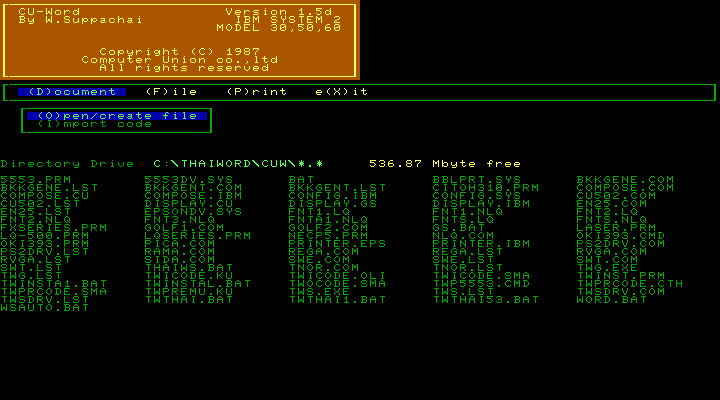
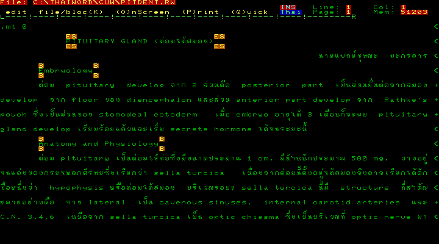

# Computer Union Word

Computer Union Word 1.5d Main Menu

Computer Union Word 1.5d Document Editor

Computer Union Word is a Thai/English word processor from Computer Union Co., Ltd.

Gold Star and IBM PS/2 Model 30, 50, 60 version is avaliable.

## Usage

* Gold Star version, run `GS.BAT` or `THAIWS.BAT`.
* IBM PS/2 version, run `WORD.BAT`.
* Use Grave Accent (`) key to toggle Thai/English input language.

## Download

* [Computer Union Word 1.5d on Internet Archive](https://archive.org/details/computer-union-word-1.5d)
* [Khralkatorrix's Thai Software Archive](https://mega.nz/folder/n9MDlbhB#33wlBLjLgh_tTo7NVkcxRQ) in `PC/Office/Computer Union/Computer Union Word/`
