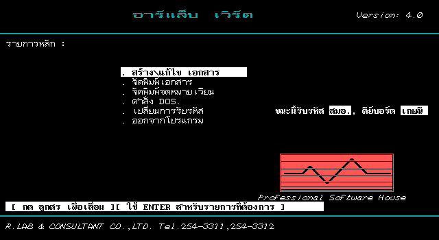
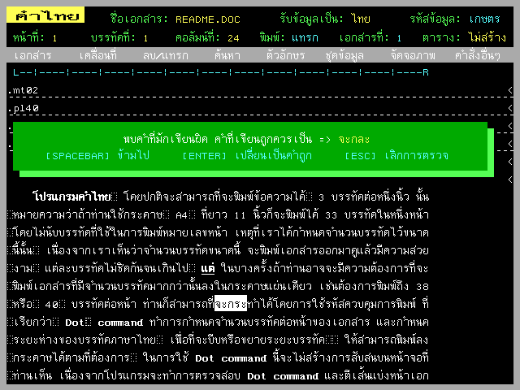

# Khum Thai (คำไทย) Word Processor

Khum Thai Word Processor Editor

Khum Thai Word Processor Spell Checking

Khum Thai (คำไทย) is a Thai/English word processor from Opus Ltd.

This software have Thai/English spell checking functionary with 20,000 Thai words and 100,000 English words, and can insert soft-space in document for use with PageMaker or other Desktop Publishing software.

## Download

* [Khum Thai (คำไทย) Word Processor on Internet Archive](https://archive.org/details/kum-thai-word-processor)
* [Khralkatorrix's Thai Software Archive](https://mega.nz/folder/n9MDlbhB#33wlBLjLgh_tTo7NVkcxRQ) in `PC/Office/Opus/`
