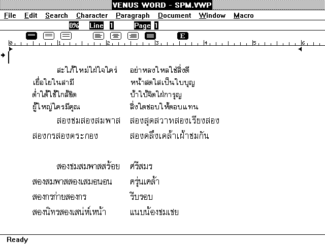

# VENUS Word Processor

VENUS Word 1.0 Editor

Thai WYSIWYG Word Processor from Computer Union Co., Ltd., release in 1991.

The software is develop using Turbo Pascal 6.0 and Metagraphics MetaWINDOW/Plus 3.0E with Computer Union Word assembly source code as core logic.

Originally release on BBS, this copy is from ftp.cs.washington.edu/pub/thaisys/BBS/venus.zip

This program support reading CU Writer 1.5x or older documents.

## Usage

* F10 -> Menu
* Grave Accent (`) -> Toggle Thai/English input language

## Download

* [VENUS Word 1.0 on Internet Archive](https://archive.org/details/venus-word-1.0)
* [Khralkatorrix's Thai Software Archive](https://mega.nz/folder/n9MDlbhB#33wlBLjLgh_tTo7NVkcxRQ) in `PC/Office/Computer Union/VENUS Word/`
